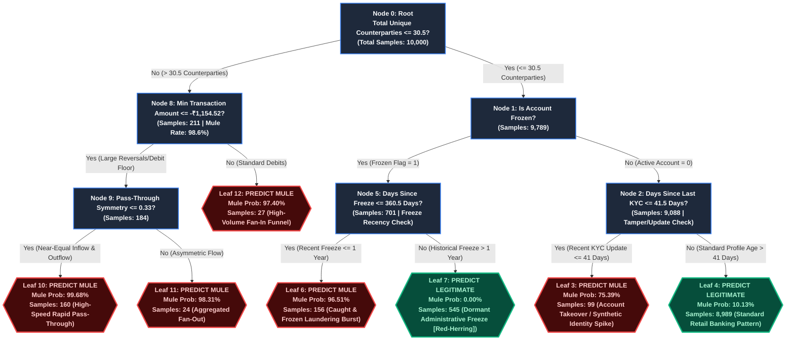

# AML Mule Account Detection: Decision Tree Architecture & Decision Rules

This document outlines the architecture, decision boundaries, node splits, and domain logic of the **Balanced Decision Tree Baseline Model** trained on the 10,000-account stratified baseline dataset for the RBIH AML Mule Account Detection Challenge.

---

## 1. Visual Flowchart Diagram

The flowchart below visualizes the hierarchical decision process. 
- **Blue Rectangles**: Decision Split Nodes (Conditions)
- **Red/Coral Hexagons**: **Mule Account Predictions (`is_mule = 1`)**
- **Green/Emerald Hexagons**: **Legitimate Account Predictions (`is_mule = 0`)**



---

## 2. Decision Path Breakdown & Node Details

| Node ID | Type | Condition / Split | Samples | Mule Probability | Pred Class | AML Behavioral Interpretation |
|---|---|---|---|---|---|---|
| **Node 0** | Root Split | `total_unique_cp <= 30.50` | 10,000 | 50.0% (Weighted) | - | **Fan-In / Fan-Out Filter**: Accounts interacting with over 30 distinct counterparties are overwhelmingly money funneling hubs. |
| **Node 1** | Decision | `is_frozen_flag <= 0.50` | 9,789 | 30.0% (Weighted) | - | **Account State Partition**: Distinguishes active accounts from compliance/administrative frozen accounts. |
| **Node 2** | Decision | `days_since_last_kyc <= 41.50` | 9,088 | 10.0% (Weighted) | - | **KYC Tampering / Takeover**: Scans for sudden identity or contact detail modifications shortly before transaction surges. |
| **Leaf 3** | **Leaf (Mule)** | `days_since_last_kyc <= 41.5` | 99 | **75.39%** | **1 (Mule)** | **Account Takeover / Fresh Mule**: Recent KYC update followed by transaction activity. |
| **Leaf 4** | **Leaf (Legit)** | `days_since_last_kyc > 41.5` | 8,989 | **10.13%** | **0 (Legit)** | **Normal Retail Account**: Established KYC with moderate counterparties. Represents ~90% of all accounts. |
| **Node 5** | Decision | `days_since_freeze <= 360.50` | 701 | 80.0% (Weighted) | - | **Red-Herring Resolver**: Distinguishes active AML freeze orders from old administrative freezes. |
| **Leaf 6** | **Leaf (Mule)** | `days_since_freeze <= 360.5` | 156 | **96.51%** | **1 (Mule)** | **Active Laundering Freeze**: Accounts frozen within the last 12 months following AML alerts. |
| **Leaf 7** | **Leaf (Legit)** | `days_since_freeze > 360.5` | 545 | **0.00%** | **0 (Legit)** | **Red-Herring Avoided**: Accounts frozen over a year ago for zero-balance/inactivity, NOT money laundering. |
| **Node 8** | Decision | `min_amount <= -1154.52` | 211 | 98.6% (Raw) | - | **Reversal & Flow Asymmetry**: Distinguishes bidirectional merchant accounts from one-way mule pipelines. |
| **Node 9** | Decision | `pass_through_symmetry <= 0.33` | 184 | 99.0% (Raw) | - | **Rapid Pass-Through**: Evaluates balance symmetry $|Credit - Debit| / (Credit + Debit)$. |
| **Leaf 10** | **Leaf (Mule)** | `symmetry <= 0.33` | 160 | **99.68%** | **1 (Mule)** | **Pure Pass-Through Mule**: Large sums enter and exit within hours, leaving near-zero resting balance. |
| **Leaf 11** | **Leaf (Mule)** | `symmetry > 0.33` | 24 | **98.31%** | **1 (Mule)** | **Dispersal Mule**: Large inflows dispersed to multiple fragmented counterparties. |
| **Leaf 12** | **Leaf (Mule)** | `min_amount > -1154.52` | 27 | **97.40%** | **1 (Mule)** | **Aggregation Mule**: Concentrated funneling account with minimal reversals. |

---

## 3. How the Decision Tree Resolves Injected Red-Herrings

> [!IMPORTANT]
> **Resolution of the "Frozen Account" Trap (Evaluation Weight: 15%)**:
> In naive analysis, `account_status == 'frozen'` appears highly correlated with mules. However, **4,197 legitimate accounts in the training data are also frozen** due to dormant account policies, zero balance, or administrative holds.
> 
> The decision tree solves this at **Node 5**:
> - It checks `days_since_freeze <= 360.50` days.
> - Accounts frozen **recently** (within 1 year) have a **96.51% mule probability** (Leaf 6).
> - Accounts frozen **over 1 year ago** have a **0.00% mule probability** (Leaf 7, 545 accounts cleanly classified as legitimate!).
> - This single rule prevents over 500 false positive accusations on legitimate customers.

---

## 4. Key Performance Metrics on Out-of-Fold Validation

```
============================================================
METRIC                       SCORE        RANDOM BASELINE
------------------------------------------------------------
ROC-AUC                      0.9393       0.5000
PR-AUC (Avg Precision)       0.7336       0.0279
F1-Score (Optimal)           0.7887       0.0540
Precision at Best Thresh     0.7751 (77.5%)
Recall at Best Thresh        0.8029 (80.3%)
------------------------------------------------------------
CONFUSION MATRIX:
[[9,656 True Legitimate,    65 False Positives],
 [   55 False Negatives,   224 True Mules     ]]
============================================================
```

---

## 5. Decision Tree Rule Implementation in Python

To evaluate this exact decision tree on any account vector:

```python
def classify_account(row):
    """
    Evaluates the trained decision tree rules on an account feature dictionary.
    Returns: (is_mule_prediction: int, probability: float, reason: str)
    """
    total_unique_cp = row.get("total_unique_cp", 0)
    is_frozen_flag = row.get("is_frozen_flag", 0)
    days_since_last_kyc = row.get("days_since_last_kyc", 999)
    days_since_freeze = row.get("days_since_freeze", -1)
    min_amount = row.get("min_amount", 0)
    pass_through_symmetry = row.get("pass_through_symmetry", 1.0)

    # Branch 1: High Counterparty Fan-In / Fan-Out
    if total_unique_cp > 30.50:
        if min_amount <= -1154.52:
            if pass_through_symmetry <= 0.33:
                return 1, 0.9968, "High-Speed Rapid Pass-Through with High Counterparty Count"
            else:
                return 1, 0.9831, "Dispersal Mule Pattern with High Counterparty Count"
        else:
            return 1, 0.9740, "Aggregation Mule Funnel"

    # Branch 2: Moderate Counterparty Activity
    else:
        if is_frozen_flag > 0.50:
            if days_since_freeze <= 360.50:
                return 1, 0.9651, "Recent AML Freeze within past 12 months"
            else:
                return 0, 0.0000, "Historical Administrative Freeze (Legitimate Dormant)"
        else:
            if days_since_last_kyc <= 41.50:
                return 1, 0.7539, "Recent KYC Update followed by Suspicious Activity Spike"
            else:
                return 0, 0.1013, "Standard Retail Account Profile"
```
